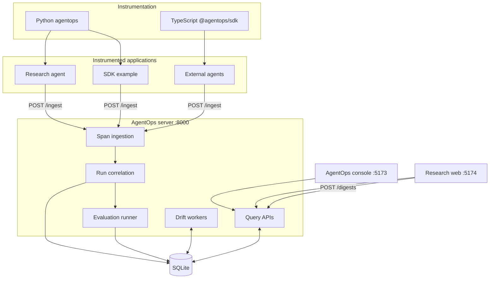
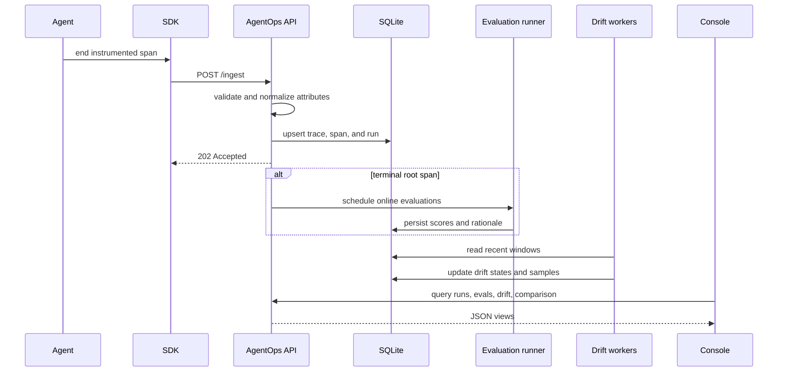

# AgentOps architecture

AgentOps is a workspace of independently runnable SDK, API, console, and example-application packages. OpenTelemetry spans are the stable boundary between instrumented agents and the platform.

## System context

## Ingestion and processing

## Package boundaries

| Package | Responsibility |
|---|---|
| `packages/agentops-py` | Data models, evaluation registry/templates, drift algorithms, OTel conventions/exporter/redaction |
| `packages/agentops-ts` | TypeScript conventions, span exporter, evaluation definitions, invariant runner |
| `packages/agentops-server` | FastAPI ingestion/query layer, SQLModel persistence, evaluation orchestration, drift processing |
| `packages/agentops-console` | Runs, traces, comparison, datasets, evaluations, and drift UI |
| `apps/agentops-research-agent` | Planner/worker research workflow with mock or real arXiv sources |
| `apps/agentops-research-web` | Digest submission, status, saved searches, and result rendering |
| `apps/agentops-sdk-example` | Framework-neutral manual instrumentation example |

Dependencies point inward: applications depend on the SDK; the server depends on SDK models and algorithms; the SDK does not depend on the server or either UI.

## Telemetry contract

AgentOps preserves standard `gen_ai.*` attributes for model, operation, usage, and token data. Platform extensions use the `agentops.*` namespace:

- `agentops.run_id` correlates spans into a run.
- `agentops.agent_name` identifies the logical agent.
- `agentops.role` identifies planner, worker, tool, or agent spans.
- `agentops.prompt_sha` connects a run to a prompt revision.
- `agentops.input` and `agentops.output` carry JSON-encoded run boundaries.
- `agentops.attribution` carries citation-weight information.
- `agentops.eval.<name>.score` carries numeric evaluation signals.

The local exporter defaults to `NoOpRedactor` so the console can inspect prompts and outputs. The opt-in `AllowlistRedactor` keeps structural metadata, approved GenAI telemetry, AgentOps correlation fields, and numeric evaluation scores while dropping prompt, completion, input, output, rationale, and arbitrary custom content. Use an explicit redactor before exporting sensitive spans.

## Persistence and consistency

The SQLite schema stores runs, spans, evaluation results, golden datasets, drift state/samples, regression jobs, digest jobs, and trace-to-run correlation. Ingestion is idempotent at the span and run boundaries. Trace correlation supports batches that arrive out of order, including child spans received before the root span carrying the run ID.

The local server creates its schema at startup. Background drift processing can be disabled with `AGENTOPS_DRIFT_LOOP=0`, which is useful for deterministic tests and one-shot tools.

## Runtime topology

- API: `agentops_server.main:app` on port 8000
- Console: Vite package `agentops-console` on port 5173
- Research UI: Vite package `agentops-research-web` on port 5174
- Database: `sqlite+aiosqlite:///./agentops.db`
- Agent exporter: `http://localhost:8000/ingest`

The Vite development servers proxy API calls to `AGENTOPS_API_PORT`. Production deployment can build the two frontends independently and point their API proxy or hosting layer at the FastAPI service.

## Current trust boundary

The repository targets a trusted local environment. The API allows local browser origins, has no authentication layer, and runs jobs and drift work in process. The exporter redaction interface provides a client-side privacy boundary, but operators remain responsible for configuring an appropriate redactor before exporting sensitive telemetry.

See [Technical overview](docs/TECHNICAL_OVERVIEW.md) for implementation details and [Roadmap](ROADMAP.md) for planned production capabilities.
