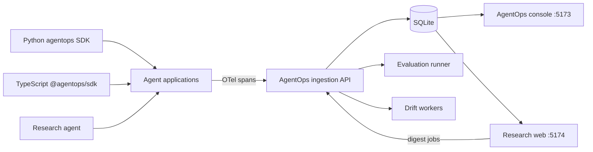

# AgentOps

AgentOps is a local-first observability, evaluation, and drift-monitoring platform for AI agents. It accepts OpenTelemetry-style spans from any agent framework, reconstructs runs and traces, applies online and regression evaluations, detects changes in production behavior, and presents the results in a focused web console.

## What it includes

- Framework-neutral Python and TypeScript instrumentation
- OpenTelemetry and GenAI semantic attributes with `agentops.*` extensions
- FastAPI ingestion and query APIs backed by SQLite
- Trace timelines, run comparison, evaluation trends, and drift dashboards
- Input, tool-call, quality, and attribution drift detectors
- An instrumented multi-agent arXiv research application with mock and live data modes
- A separate research digest UI and a minimal Anthropic SDK example

## Repository layout

```text
AgentOps/
├── .github/workflows/
├── apps/
│   ├── agentops-research-agent/
│   ├── agentops-research-web/
│   └── agentops-sdk-example/
├── docs/
│   ├── architecture/
│   ├── diagrams/
│   ├── screenshots/
│   └── TECHNICAL_OVERVIEW.md
├── evaluations/golden/
├── packages/
│   ├── agentops-py/
│   ├── agentops-server/
│   ├── agentops-ts/
│   └── agentops-console/
├── scripts/
├── ARCHITECTURE.md
├── CHANGELOG.md
├── ROADMAP.md
├── Makefile
├── package.json
└── pyproject.toml
```

## Architecture



The SDKs serialize spans to `POST /ingest`. The server correlates them by trace and `agentops.run_id`, persists runs and spans, starts evaluations after terminal runs, and updates drift state in the background. Both web applications query the same API without changing the ingestion contract.

## Prerequisites

- Python 3.12+
- [uv](https://docs.astral.sh/uv/)
- Node.js 20+
- pnpm 9+

## Five-minute mock-mode quick start

Install the workspaces:

```bash
uv sync --all-packages
pnpm install
```

Start the API and two frontends in separate terminals:

```bash
make server   # http://localhost:8000
make web      # http://localhost:5173
make digest   # http://localhost:5174
```

Populate deterministic local data without API keys:

```bash
uv run python scripts/load_golden.py
uv run python scripts/seed_drift.py
```

Open `http://localhost:5173` for observability and `http://localhost:5174` for research digests. Mock arXiv data is the default; the SQLite database is created as `agentops.db` in the repository root.

The bundled mock corpus and generated drift runs are synthetic demo data. Their arXiv-style identifiers, authors, abstracts, results, and figures must not be treated as real papers or research findings. Real arXiv mode retrieves metadata and abstracts; it does not read full PDFs or extract their figures.

On Windows PowerShell, run the API and frontends in separate terminals instead of using `make`:

```powershell
uv run uvicorn agentops_server.main:app --reload --port 8000
pnpm --filter agentops-console dev
pnpm --filter agentops-research-web dev
```

## Instrument an agent

### Python

```python
from opentelemetry import trace
from agentops.otel import AgentOps, install

install(service_name="my-agent")
tracer = trace.get_tracer("my-agent")

with tracer.start_as_current_span("agent.run") as span:
    span.set_attribute(AgentOps.RUN_ID, "run-123")
    span.set_attribute(AgentOps.AGENT_NAME, "my-agent")
    span.set_attribute(AgentOps.ROLE, "planner")
    span.set_attribute(AgentOps.INPUT, '{"question":"What changed?"}')
```

### TypeScript

```ts
import { AgentOps, AgentOpsSpanExporter } from "@agentops/sdk";

const exporter = new AgentOpsSpanExporter({
  endpoint: process.env.AGENTOPS_ENDPOINT,
});

const attributes = {
  [AgentOps.RunId]: "run-123",
  [AgentOps.AgentName]: "my-agent",
  [AgentOps.Role]: "planner",
};
```

The Python installer exports synchronously by default and accepts `batched=True` for long-running, high-throughput processes. Both exporters support the same `/ingest` payload and retry behavior.

The Python exporter preserves span attributes by default for local trace inspection. Prompts and outputs can be sent to the local server; configure `AllowlistRedactor` before exporting sensitive data. Cost figures use a small built-in pricing table and are estimates, especially for models outside that table.

## Live mode

Set an Anthropic key and opt into real arXiv queries:

```bash
export ANTHROPIC_API_KEY="..."
export AGENTOPS_USE_REAL_ARXIV=1
export AGENTOPS_CHEAP_MODEL="claude-haiku-4-5"
export AGENTOPS_QUALITY_MODEL="claude-sonnet-4-6"

uv run python -m agentops_research_agent \
  "agent evaluation and observability" 2024-01-01 2024-12-31
```

Real arXiv mode uses the public arXiv API. The model-powered planner, synthesis, vision analysis, and judge evaluations require `ANTHROPIC_API_KEY`.

## Configuration

| Variable | Default | Purpose |
|---|---|---|
| `AGENTOPS_ENDPOINT` | `http://localhost:8000/ingest` | SDK export endpoint and child-agent ingestion endpoint |
| `AGENTOPS_DB_URL` | `sqlite+aiosqlite:///./agentops.db` | Async SQLAlchemy database URL |
| `AGENTOPS_API_PORT` | `8000` | API port passed to Make/Vite proxy commands |
| `AGENTOPS_ONLINE_EVAL_SAMPLE_RATE` | `1.0` | Fraction of completed runs selected for online evaluation |
| `AGENTOPS_JUDGE_MODEL_DEFAULT` | `claude-haiku-4-5` | Default server-side judge model |
| `AGENTOPS_COST_BUDGET_DEFAULT` | `0.50` | Server default cost budget in USD |
| `AGENTOPS_COST_BUDGET_USD` | `0.50` | SDK invariant budget in USD |
| `AGENTOPS_FIGURES_DIR` | bundled mock figure directory | Directory served by the figures API |
| `AGENTOPS_DRIFT_LOOP` | `1` | Set to `0` to disable background drift processing |
| `AGENTOPS_RUN_ID` | generated | Correlation ID injected into a research-agent job |
| `AGENTOPS_USE_REAL_ARXIV` | unset | Any non-empty value enables real arXiv data |
| `AGENTOPS_CHEAP_MODEL` | `claude-haiku-4-5` | Planning, extraction, and low-cost model |
| `AGENTOPS_QUALITY_MODEL` | `claude-sonnet-4-6` | Higher-quality synthesis model |
| `ANTHROPIC_API_KEY` | unset | Credential for live model calls and judge evaluations |

## Development commands

```bash
make server       # FastAPI on :8000
make web          # AgentOps console on :5173
make agent        # research-agent CLI
make digest       # research web on :5174
make test         # Python and TypeScript tests
make lint         # Ruff and ESLint
make typecheck    # mypy and TypeScript checks
pnpm -r build     # all TypeScript production builds
```

Useful direct commands:

```bash
uv run pytest -m "not live"
uv run ruff check .
uv run mypy packages/agentops-py/src packages/agentops-server/src apps/agentops-research-agent/src
pnpm --filter agentops-console dev
pnpm --filter agentops-research-web dev
pnpm --filter @agentops/sdk build
```

## HTTP API

The server exposes health and ingestion endpoints, run and trace queries, digest jobs, drift state and series, evaluation results, datasets, regression runs, run comparison, and bundled research figures. Interactive OpenAPI documentation is available at `http://localhost:8000/docs` while the server is running.

Core endpoints include `GET /healthz`, `POST /ingest`, `GET /runs`, `GET /runs/{run_id}`, `GET /compare`, `GET /drift`, `GET /evals/recent`, `GET /datasets`, `POST /regressions`, and `GET|POST /digests`.

## Operational scope

AgentOps is designed for local development and portfolio-scale evaluation workflows. It uses a single SQLite database, in-process background workers, and permissive local CORS settings. Authentication, tenancy enforcement, distributed queues, and production database migrations are intentionally future work.

## Documentation

- [Architecture](ARCHITECTURE.md)
- [Technical overview](docs/TECHNICAL_OVERVIEW.md)
- [Roadmap](ROADMAP.md)
- [Screenshots](docs/screenshots/README.md)
- [Walkthrough video](docs/walkthrough.mp4)


